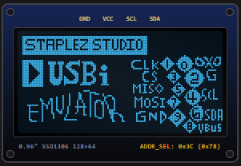

<div align="center">

[](https://github.com/staplez-studio/BluePill_Extra_Applications)


# USBi Emulator for the Blue Pill (STM32F103C8)
### Dx-Smart-PJ26 · v1.2 Edition

**Make an STM32F103 board appear to Windows and SigmaStudio as an Analog Devices USBi, and translate its requests into I²C or SPI for SigmaDSP targets.**


[Overview](#overview) · [Quick Start](#quick-start) · [Hardware](#hardware) · [Flashing](#flashing) · [OLED](#oled-status-display) · [Testing](#first-test-with-sigmastudio) · [Troubleshooting](#troubleshooting) · [Protocol](#protocol-summary) · [Legal](#legal-and-safety)

</div>

---

## Table of Contents

1. [Overview](#overview)
2. [Project Status](#project-status)
3. [How It Works](#how-it-works)
4. [Features](#features)
5. [Quick Start](#quick-start)
6. [Hardware](#hardware)
7. [Wiring](#wiring)
8. [Windows Drivers](#windows-drivers)
9. [Flashing](#flashing)
10. [Verifying USB Enumeration](#verifying-usb-enumeration)
11. [OLED Status Display](#oled-status-display)
12. [First Test with SigmaStudio](#first-test-with-sigmastudio)
13. [Switching to the RUN Firmware](#switching-to-the-run-firmware)
14. [Building from Source](#building-from-source)
15. [Configuration Options](#configuration-options)
16. [Using a Standard Blue Pill](#using-a-standard-blue-pill)
17. [Troubleshooting](#troubleshooting)
18. [Protocol Summary](#protocol-summary)
19. [Firmware Architecture](#firmware-architecture)
20. [Known Limitations](#known-limitations)
21. [Repository Layout](#repository-layout)
22. [Contributing and Feedback](#contributing-and-feedback)
23. [Legal and Safety](#legal-and-safety)
24. [License](#license)
25. [Credits and Sources](#credits-and-sources)

---

## Overview

**SigmaStudio**, Analog Devices' graphical tool for SigmaDSP audio processors (for example the ADAU1701), normally needs an official **USBi** dongle. This project turns an STM32F103C8T6 board into a stand-in for it.

Once flashed, the board enumerates on the PC as an **Analog Devices USBi** (USB `VID_0456 & PID_7031`). The firmware answers the USBi's USB **vendor requests** and translates them into **I²C** or **SPI** transfers for the DSP target.

This edition is built for the **DX-SMART DX-PJ26** board (STM32F103C8T6 plus a CH340 USB-serial chip, with the LoRa module removed). A standard Blue Pill is also supported through a build option; see [Using a Standard Blue Pill](#using-a-standard-blue-pill).

The USBi protocol was **recovered by analysing the USBi firmware image from a SigmaStudio installation**, not guessed. The findings and evidence are in [`docs/PROTOCOL.md`](docs/PROTOCOL.md).

## Project Status

| Item | State |
|------|-------|
| Firmware compiles | ✅ |
| Intel hex files validated | ✅ |
| Request-to-I²C/SPI translation tested on a PC against simulated devices | ✅ |
| OLED screen logic tested on a PC | ✅ |
| **Tested against real SigmaStudio on real hardware** | ⚠️ **Not yet** |

> **This is a pre-release.** The first real-hardware run is the purpose of the setup guide. The debug-logging firmware exists so that, if SigmaStudio asks for something the emulator doesn't implement, the request is visible in the log and on the OLED. **Test reports are the most valuable contribution you can make.**

## How It Works

```text
┌──────────────┐  USB 0456:7031   ┌──────────────────────┐  I²C or SPI   ┌─────────────┐
│ SigmaStudio  │ ───────────────▶ │ STM32F103C8T6        │ ────────────▶ │ SigmaDSP    │
│ (Windows PC) │  vendor requests │ USBi emulation       │               │ target      │
│              │ ◀─────────────── │ (all traffic on EP0) │ ◀──────────── │             │
└──────────────┘                  └──────────┬───────────┘               └─────────────┘
                                             │
                          ┌──────────────────┼───────────────────┐
                          ▼                  ▼                   ▼
                   OLED status screen   UART debug log     Heartbeat LED
                   (PB13 / PB14)        (PA9 or PA2)       (PB11)
```

1. Windows sees a USBi and binds Analog Devices' driver (Cypress `CyUSB`).
2. SigmaStudio sends vendor requests on the control endpoint to read or write DSP memory.
3. The firmware decodes each request and performs the matching I²C or SPI transaction.
4. Status and read data go back to the host over USB. The OLED and optional UART log show what is happening.

## Features

- **Presents as a genuine USBi** (`0456:7031`), listed in Windows as *Analog Devices USBi (programmed)*
- **I²C master** (default 100 kHz) and **SPI master** (default ~500 kHz, mode 3) with up to **five chip-selects**
- **Target control lines:** reset pulse output and two auxiliary outputs
- **1.3" OLED status screen** showing USB state, last transfers, error counters and the last unsupported request
- **Three prebuilt firmwares:** two logging builds and one clean RUN build
- **Flash over the board's own USB-C port.** No programmer, jumper wires or adapter needed on the DX-PJ26
- **Unsupported requests are flagged** (`!` in the log, `Unk` on the OLED) and stalled when they carry no data stage
- **Host-side unit tests** for the translation layer and the OLED screen
- Rebuildable with `make` and the Arm GNU toolchain

---

## Quick Start

> The full walkthrough, from unzipping to a working setup, is in [`docs/USBi_PJ26_Guide.md`](docs/USBi_PJ26_Guide.md) (also available as `.html`). Pin tables and wiring diagrams are in [`docs/PINOUT.md`](docs/PINOUT.md).

1. **Prepare the board.** Make sure the LoRa module is **not fitted**, then confirm with a multimeter that the board's own USB-C D+/D− have **no continuity** to PA12/PA11.
2. **Wire it** (everything unplugged): 1.5 kΩ resistor from `PA12` to 3V3; USB-C breakout D+ → `PA12`, D− → `PA11`, GND → GND; OLED to `PB13`/`PB14`/3V3/GND.
3. **Install the driver** if needed (SigmaStudio's `CyUSB` driver package).
4. **Flash** `firmware/hex/USBi_PJ26_LOG_CH340.hex` with **MCUISP** over the board's own USB-C port, with the breakout cable unplugged.
5. **Plug in the breakout cable** on a second USB port. Windows should show *Analog Devices USBi (programmed)* and the OLED should read `CFG`.
6. **Wire the DSP**, run **Link-Compile-Download** in SigmaStudio, and watch the log and OLED.
7. **Send the log** (especially any `!` lines) if anything fails.

---

## Hardware

### Requirements

| Item | Notes |
|------|-------|
| **DX-SMART DX-PJ26** board | STM32F103C8T6 + CH340. **LoRa module removed** |
| USB-C cable | Board's own port: power, flashing, optional log |
| **USB-C breakout board** + cable | D+, D−, GND pads. This is the USBi connection seen by SigmaStudio, on a **second** PC USB port |
| **1.5 kΩ resistor** | USB D+ pull-up, `PA12` to 3.3 V. **Required** |
| 1.3" I²C OLED (VCC, GND, SCL, SDA) | Optional but recommended |
| Jumper wires | Plus two 4.7 kΩ resistors for I²C pull-ups only if the DSP board has none |
| DSP target board | I²C or SPI, **3.3 V I/O** |
| 3.3 V USB-serial adapter | Optional: only for the `_LOG_PA2` firmware |
| ST-Link V2 | Optional: fallback flashing |

### Software (Windows PC)

- **SigmaStudio** (provides the Analog Devices USB driver files)
- **MCUISP** (free Windows UART flasher for STM32)
- **CH340 driver** if Windows doesn't already show a COM port for the board
- A serial terminal (Tera Term, PuTTY, HTerm)

### Why Two USB Connections?

The DX-PJ26's own USB-C goes to a **CH340 USB-serial chip** and is used only for power, flashing and the optional log. The emulator's USB connection is a **separate** link from `PA11`/`PA12` to your USB-C breakout.

```text
PC USB port 1 ── DX-PJ26 USB-C ─────▶ power + COM port (CH340): flashing, optional log
PC USB port 2 ── USB-C breakout ────▶ D+/D−/GND only → PA12/PA11/GND  (the USBi seen by SigmaStudio)
```

---

## Wiring

> All signals are **3.3 V logic**. Never connect 5 V to any pin. **Join all grounds** (board, breakout, OLED, target). Never connect the breakout's VBUS to anything.

### Pin Assignment

| Function | Pin | Direction | Notes |
|----------|-----|-----------|-------|
| **I²C SCL** (to DSP) | `PA0` | open-drain out | Needs ~4.7 kΩ pull-up to 3.3 V unless the DSP board has one |
| **I²C SDA** (to DSP) | `PA1` | open-drain, bidir | Same |
| **Debug log TX** (`_LOG_PA2`) | `PA2` | UART TX, 115200 8N1 | To an external adapter's **RX** |
| **Target RESET** (request B7) | `PA3` | open-drain, idles released | Target needs a pull-up |
| **SPI CS1** | `PA4` | out, idles high | `wIndexH` = 1. **Use for a single DSP** |
| **SPI SCLK** | `PA5` | out | Mode 3 (idles high), MSB first, ~500 kHz |
| **SPI MISO** | `PA6` | in (pull-up) | DSP CDATAO |
| **SPI MOSI** | `PA7` | out | DSP CDATA |
| SPI CS2 | `PB0` | out, idles high | `wIndexH` = 2 |
| SPI CS3 | `PB1` | out, idles high | `wIndexH` = 3 |
| SPI CS4 | `PB10` | out, idles high | `wIndexH` = 4 |
| SPI CS5 | `PC13` | out, idles high | `wIndexH` = 5 (slow pin: 2 MHz, ~3 mA) |
| **Heartbeat LED** | `PB11` | out | User LED on the DX-PJ26 V1.2. Blinks once per second |
| AUX1 (request B8) | `PC14` | push-pull, slow | Idles high. Level = (`wValueL` ≠ 0). Function inferred ("power board") |
| AUX2 (request B9) | `PC15` | push-pull, slow | Idles high. Low when `wValueL` = 1. Function inferred ("LED") |
| **USB D−** | `PA11` | USB | To breakout D− |
| **USB D+** | `PA12` | USB | To breakout D+, **plus 1.5 kΩ to 3.3 V** |
| **OLED SCL / SDA** | `PB13` / `PB14` | open-drain | 1.3" I²C OLED, address 0x3C |
| Debug log TX (`_LOG_CH340`) | `PA9` | UART TX | Already wired to the CH340: log appears on the board's own COM port |
| CH340 RX (flashing) | `PA10` | UART RX | Already wired on the board |

> `PC13`, `PC14` and `PC15` are limited by the chip to ~3 mA at up to 2 MHz and may share pins with an on-board 32.768 kHz crystal. They carry only slow, static signals. The original USBi's two mode LEDs are not implemented.
>
> The LoRa module drives `PA0`-`PA7` and `PC15`, so it **must not be fitted**.

### USB-C Breakout

```text
USB-C breakout                        DX-PJ26
--------------                        -------
D+  ──────────────────────────────── PA12
D−  ──────────────────────────────── PA11
GND ──────────────────────────────── GND
VBUS: leave unconnected               (board is powered via its own USB-C)
CC1, CC2: 5.1 kΩ to GND on breakout   (fitted on most breakouts)

           3.3 V ──[ 1.5 kΩ ]── PA12   ◀ REQUIRED: tells the PC a full-speed device is present
```

- The pull-up is **required**: the DX-PJ26 has none on `PA12`, and breakouts don't fit one.
- Breakouts usually have two D+ and two D− pads (reversible connector), tied together, so use either.
- The pull-up is always on. **Unplug the breakout cable while flashing**, or Windows will show an unknown device.
- On the DX-PJ26, `PA11`/`PA12` come out on header **P3** (the schematic shows pins 9 and 10; check your silkscreen).

### OLED (optional)

```text
1.3" I²C OLED                         DX-PJ26
VCC ──────────────────────────────── 3V3
GND ──────────────────────────────── GND
SCL ──────────────────────────────── PB13
SDA ──────────────────────────────── PB14
```

### I²C Target (for example an ADAU1701 board)

```text
DX-PJ26                               Target DSP board
PA0 (SCL) ─────────────────────────── SCL
PA1 (SDA) ─────────────────────────── SDA
GND ───────────────────────────────── GND
PA3 (RESET, open-drain) ───────────── /RESET     (optional; target needs a pull-up)
        3.3 V ──[4.7k]── SDA          (only if the target has no pull-ups)
        3.3 V ──[4.7k]── SCL          (only if the target has no pull-ups)
```

The target's IOVDD must be **3.3 V**. Power it from its own supply.

### SPI Target

```text
DX-PJ26                               Target DSP board
PA5 (SCLK) ────────────────────────── CCLK / SCLK
PA7 (MOSI) ────────────────────────── CDATA / MOSI
PA6 (MISO) ────────────────────────── CDATAO / MISO
PA4 (CS1)  ────────────────────────── CLATCH / SS   (CS1 for the first device)
GND ───────────────────────────────── GND
```

For an I²C-only setup, leave the SPI wires disconnected.

---

## Windows Drivers

The firmware identifies as `USB\VID_0456&PID_7031` ("USBi (programmed)"). Analog Devices' driver package already contains an entry for that ID, bound to Cypress's generic `CyUSB` driver. The firmware-download step in that package applies only to the other ID (`PID_7030`) and is not used.

1. **Check if installed:** if SigmaStudio installed its USB driver, `C:\Windows\System32\drivers\CyUSB.sys` normally exists. If so, you're done.
2. **Otherwise,** open SigmaStudio's USB driver folder (containing `CyUSB.inf`, `CyUSB.sys`, `CyUSB.cat`, `dpinst32.exe`, `dpinst64.exe`) and run **`dpinst64.exe` as administrator** (`dpinst32.exe` on 32-bit Windows).
3. **If that fails:** Device Manager → right-click the device → *Update driver* → *Browse my computer* → *Let me pick* → *Have Disk…* → select `CyUSB.inf` → **Analog Devices USBi (programmed)**.
4. The **CH340 driver** (for the board's COM port) is separate. Windows 10/11 normally installs it automatically; otherwise get it from WCH.

---

## Flashing

The board's USB-C goes to a CH340 wired to the STM32's serial bootloader pins, so **MCUISP flashes it directly** with no jumpers or adapter.

### Choosing a Firmware

| File | Log | Use |
|------|-----|-----|
| `firmware/hex/USBi_PJ26_LOG_CH340.hex` | On the board's own COM port (`PA9`) | **Flash this first** |
| `firmware/hex/USBi_PJ26_LOG_PA2.hex` | On `PA2` (needs an external 3.3 V USB-serial adapter) | If DTR/RTS from a terminal disturbs the board |
| `firmware/hex/USBi_PJ26_RUN.hex` | None | Final version once everything works |

Each is also provided as a `.bin`.

### Steps (MCUISP)

1. **Unplug the USB-C breakout cable.** Plug in **only** the board's own USB-C cable.
2. In **Device Manager → Ports (COM and LPT)** find *USB-SERIAL CH340 (COMx)*.
3. Start **MCUISP** (some versions are partly in Chinese; the functions are the same).
4. **Open** `firmware\hex\USBi_PJ26_LOG_CH340.hex`.
5. Select your **COMx** and **115200** baud.
6. **DTR/RTS auto-entry:** choose `Reset@DTR High(>+3V), ISP@RTS Low` (from DX-SMART's PJ26 troubleshooting guide). If that fails, try `Reset@DTR Low(<-3V), ISP@RTS Low` (used by a community V1.1 guide).
7. Tick **Verify** and **Run after programming**. Leave option bytes and read-protection alone.
8. Click **Read ChipInfo** (or connect) and **immediately press the board's RST button.** This timing is what makes it connect on the DX-PJ26. The chip ID is normally `0x410`.
9. Click **Start programming** and watch for erase, 100 % programming, **verify OK**, run.
10. Press **RST** or replug. The **PB11 LED blinks once per second** and the OLED shows the status screen.

### If Connecting Fails

| Symptom | Fix |
|---------|-----|
| "No response from the bootloader" | Press RST right after clicking connect. Try the other DTR/RTS option. Try 57600 baud |
| Wrong COM port / busy | Close any terminal on that port. Re-check the COM number |
| Works only sometimes | Short cable, direct PC port (no hub) |
| Never connects | **ST-Link V2 fallback:** wire GND, SWDIO, SWCLK to the SWD header pins G, D, C (leave V disconnected if USB-powered) and flash the `.hex` with STM32CubeProgrammer |

> **DTR/RTS caution:** On this board a CH340 control line also reaches the STM32's BOOT0/reset. Some terminals assert DTR/RTS when opening the port, which can reset the board or send it to the bootloader on its next reset. If the board stops when you open a terminal, disable DTR/RTS in the terminal or use the `_LOG_PA2` firmware with an external adapter.

### Verify File Integrity

Windows: `certutil -hashfile <file> SHA256`

| File | Size (bytes) | SHA-256 |
|------|--------------|---------|
| `USBi_PJ26_LOG_CH340.hex` | 49971 | `234e8304523ebe878995d9e5b06247a3d6406cbb24b3956a9a24ffefae8daabc` |
| `USBi_PJ26_LOG_PA2.hex` | 49971 | `97937f083ba79c8e66754ebee14555695d11282d3667d5b7d48878b7379673bb` |
| `USBi_PJ26_RUN.hex` | 48404 | `36b6e629bd8e03f9fb9b446159f1b7663cd74f4b375327c0c7137e8817e5bcf1` |

---

## Verifying USB Enumeration

1. Plug the **breakout cable** into a **second** PC USB port. The board's own USB-C stays connected for power.
2. **Device Manager** should list **Analog Devices USBi (programmed)**. Under *Details → Hardware Ids* it must show `USB\VID_0456&PID_7031`.
3. **"Unknown USB Device (Device Descriptor Request Failed)":** check the 1.5 kΩ pull-up, D+/D− not swapped, short wires, joined grounds; replug.
4. **Right ID but a driver warning:** install the driver ([Windows Drivers](#windows-drivers)).

The **OLED shows enumeration progress** at the top right:

| Code | Meaning |
|------|---------|
| `---` | USB not started or no host |
| `DEF` | PC reset the bus but enumeration didn't finish (check D+/D−, pull-up, cable) |
| `ADR` | Address assigned but no driver has configured the device (install the driver) |
| `CFG` | **Driver loaded and configured. This is the goal.** |
| `SUS` | Bus suspended (PC asleep or cable unplugged) |

---

## OLED Status Display

Eight lines of 21 characters, refreshed about ten times a second:

```text
USBi 0456:7031    CFG      ← title and USB state
Bus I2C   Addr 0x34        ← bus of the last transfer and its address (SPI shows the CS)
Last WR 00004B  OK         ← last write: bytes and result (OK / NACK / BERR)
Last RD 00002B  OK         ← last read: bytes and result
WR 00012 RD 00005          ← total write / read transfers
NACK 003 BERR 000          ← slave-did-not-answer and bus-error counts
B2 v0034 i0000 l0004       ← last request: code, wValue, wIndex, wLength
Unk C3 x02 Up 0:12:34      ← last UNKNOWN request (and count), then uptime
```

`Unk` is the quickest way to spot an unsupported request without a terminal.

**If the OLED misbehaves** (rebuild with the [options](#configuration-options)):

- **Blank:** check `PB13` = SCL, `PB14` = SDA, 3.3 V, and the address (0x3C default; some modules use 0x3D). The firmware skips the display if it gets no answer.
- **Shifted by two pixels / garbage:** the module is an SSD1306, not an SH1106 → `OLED_SH1106=0`.
- **Upside down:** `OLED_FLIP=0`.

---

## First Test with SigmaStudio

1. **Open the log** (pick one):
   - `_LOG_CH340`: terminal on the board's own COMx at **115200 8N1, no flow control**, DTR/RTS off if possible.
   - `_LOG_PA2`: adapter **RX → PA2**, GND → GND, adapter's COM port at 115200 8N1.
2. **Wire the DSP** (power off), then power it on.
3. Start **SigmaStudio**, configure your hardware as for a normal USBi, confirm detection, and run **Link-Compile-Download**.
4. **Watch the terminal and OLED.** Each request is one line:

```text
O rt=40 rq=B2 v=0034 i=0000 l=0004 : 00 10 AA BB    ← write sub-address 0x0010 + data to I²C 0x34
I rt=C0 rq=B5 v=0000 i=0000 l=0001                   ← host asks for the write status
O rt=40 rq=B3 v=0034 i=0000 l=0002 : 00 10           ← set sub-address for a read
I rt=C0 rq=B4 v=0034 i=0000 l=0002                   ← read 2 bytes
I rt=C0 rq=B6 v=0000 i=0000 l=0001                   ← read status
O rt=40 rq=C3 v=0000 i=0000 l=0000 !                 ← "!" = a request the emulator does NOT know
```

`O` = host→device (first 16 data bytes shown), `I` = device→host, `rt` = request type, `rq` = request code, `v`/`i`/`l` = wValue/wIndex/wLength, trailing `!` = not implemented.

5. **Save the log** and attach it to your report, especially any `!` lines.

**Success** means SigmaStudio finishes the download without error, the DSP's parameters change, and no `!` lines or `Unk` counts appear.

## Switching to the RUN Firmware

The LOG firmware prints inside the USB interrupt, which adds a few milliseconds per request. Once everything works, reflash with **`USBi_PJ26_RUN.hex`** (breakout cable unplugged). The OLED screen stays.

---

## Building from Source

The prebuilt hex files are enough to use the board. Rebuild to change pins, speeds or the display.

1. Install the **Arm GNU Toolchain** (`arm-none-eabi-gcc`) and `make`. On Windows, the easiest source of both is **STM32CubeIDE** (look under its `plugins` folder for `gnu-tools-for-stm32` and the bundled `make`) or MSYS2:
   `pacman -S make mingw-w64-ucrt-x86_64-arm-none-eabi-gcc`
2. In `firmware/`:

   ```bash
   make clean
   make all-hex
   ```

   Other forms:

   | Command | Result |
   |---------|--------|
   | `make all-hex` | All three hex files into `firmware/hex/` |
   | `make LOG=0` | RUN firmware only |
   | `make LOG=1 LOGUART=1` | Log on `PA9` |
   | `make LOG=1 LOGUART=2` | Log on `PA2` |

3. **STM32CubeIDE:** *File → New → Makefile Project with Existing Code*, select `firmware`, then *Project → Build All*.

Pin assignments live in `firmware/USBi/usbi_hw.c`, `board.h` and `oled_hw.c`.

## Configuration Options

Pass options to make, for example:

```bash
make all-hex EXTRA_DEFS="-DUSBI_I2C_HZ=400000 -DOLED_SH1106=0"
```

| Setting | Default | Meaning |
|---------|---------|---------|
| `USBI_I2C_HZ` | 100000 | I²C clock to the DSP (try 400000 if the target allows) |
| `USBI_SPI_HZ` | 500000 | SPI clock |
| `USBI_BUF_SIZE` | 4096 | Largest single transfer accepted |
| `OLED_SH1106` | 1 | 1 = SH1106 (typical 1.3"), 0 = SSD1306 |
| `OLED_FLIP` | 1 | 0 = rotate the picture 180° |
| `OLED_ADDR8` | 0x78 | OLED address, 8-bit form (0x78 = 7-bit 0x3C, 0x7A = 0x3D) |
| `OLED_I2C_HZ` | 400000 | OLED bus speed (try 100000 if flaky) |
| `BOARD` | `PJ26` | `BOARD=BLUEPILL` for a standard Blue Pill (the source macro is `USBI_BOARD_PJ26`: 1 = DX-PJ26, 0 = Blue Pill) |
| `USBI_LOG` | 1 in source | 1 = log every request, 0 = no log. The Makefile's `LOG=` option sets this |
| `USBI_LOG_UART` | 2 in source | 1 = `PA9` (USART1, board's COM port), 2 = `PA2` (USART2). The Makefile's `LOGUART=` option sets this |

## Using a Standard Blue Pill

Build with `make BOARD=BLUEPILL all-hex` (LED on `PC13`, CS5 on `PB11`).

- A Blue Pill's USB connector is already wired to `PA11`/`PA12`, so **no breakout is needed**. Check that its D+ pull-up **R10 is 1.5 kΩ**.
- It has **no CH340**. Flash through the serial bootloader with a 3.3 V USB-serial adapter: adapter TXD → `PA10`, RXD → `PA9`, GND → GND; `BOOT0` jumper to 1; press reset; program with MCUISP; then `BOOT0` back to 0.
- For the log, use the `_LOG_PA2` build and move the adapter RX to `PA2`.

---

## Troubleshooting

| Problem | Likely cause and fix |
|---------|----------------------|
| No heartbeat, OLED blank | Firmware not running: flashing failed, or board not reset afterwards. Press RST and re-flash. Also possible: the 8 MHz crystal failed to start, or a fault halted the CPU (see [Firmware Architecture](#firmware-architecture)) |
| Terminal shows nothing | `_LOG_CH340`: right COM port (the board's, not the breakout's), 115200 8N1? `_LOG_PA2`: adapter RX on `PA2`? Only LOG firmware prints |
| Board resets/stops when the terminal opens | Terminal asserts DTR/RTS. Disable it, or use `_LOG_PA2` |
| Windows "device descriptor request failed" / OLED `DEF` | Missing 1.5 kΩ pull-up, D+/D− swapped or loose, long wires, ground not joined |
| OLED `ADR`, never `CFG` | Driver not installed or bound ([Windows Drivers](#windows-drivers)) |
| OLED `CFG` but SigmaStudio sees no USBi | Hardware Ids must be `VID_0456&PID_7031`. Restart SigmaStudio, replug the breakout. If no requests appear in the log, SigmaStudio never reached the device |
| `!` lines / `Unk` counts | Unimplemented request. Send the log |
| Write requests logged but nothing reaches the DSP while the OLED shows `ADR` | Data-stage writes are only executed once the device is configured (`CFG`). Fix the driver first |
| Writes report NACK | DSP didn't answer: wrong address, no SDA/SCL pull-ups, wiring, target unpowered |
| BERR | SDA or SCL stuck low: short or missing ground |
| Reads return zeros/garbage | Check the sub-address bytes (B3 data) in the log and the DSP address pins |
| SPI does nothing | `wIndexH` selects CS1-CS5 (`PA4`, `PB0`, `PB1`, `PB10`, `PC13`) |
| MCUISP cannot connect | See [If Connecting Fails](#if-connecting-fails) |

---

## Protocol Summary

Full details and evidence are in [`docs/PROTOCOL.md`](docs/PROTOCOL.md). The final USBi image (VID `0456`, PID `7031`, class `0xFF`, four bulk endpoints) carries **all traffic on EP0** via vendor requests:

| bRequest | Dir | Meaning |
|----------|-----|---------|
| `B0` | none | No-op |
| `B1` | IN, 1 byte | Returns 0 (purpose unknown) |
| `B2` | OUT | **Write.** `wValueL` = address, `wIndexL` 0 = I²C / nonzero = SPI, `wIndexH` = SPI CS 1-5. Data = payload. Bus released afterwards |
| `B3` | OUT | Same as B2 but **bus held** (register address before a read) |
| `B4` | IN | **Read** `wLength` bytes (repeated START for I²C; SPI continues with CS held) |
| `B5` | IN, 1 byte | Status of last B2/B3 |
| `B6` | IN, 1 byte | Status of last B4 |
| `B7` | none | Target reset pulse (`PA3`) |
| `B8` / `B9` | none | AUX1 / AUX2 outputs (`PC14` / `PC15`) |

**Status byte:** `1` OK · `2` more data pending · `3` no ACK · `4` bus error.

A SigmaDSP register read is `B3` (sub-address) → `B4` (n bytes) → `B6` (status).

## Firmware Architecture

The firmware is a bare-metal C program built on ST's **STM32Cube HAL** and **USB device library**, with a custom vendor-class driver that implements the USBi protocol. The I²C and SPI masters are **bit-banged** with the Cortex-M3 cycle counter (`DWT->CYCCNT`), which keeps them free of HAL timeouts and safe to run inside the USB interrupt, and gives exact control over START, repeated START and chip-select.

### Startup Sequence (`main.c`)

1. `HAL_Init()` and `SystemClock_Config()`.
2. The heartbeat LED GPIO is configured (`HB_PIN` / `HB_PORT` from `board.h`: `PB11` on the DX-PJ26, `PC13` on a Blue Pill).
3. `USBI_Start()`:
   1. `usbi_hw_init()` sets up the bus pins (levels first, then output mode) and, in LOG builds, the debug UART.
   2. **Forces USB re-enumeration:** drives `PA12` low for 20 ms, then releases it. This matters because the external 1.5 kΩ pull-up is always on.
   3. Initialises the USB library, registers the USBi class and starts the device.
4. `ui_init()` probes the OLED. If no display acknowledges its address, the screen is skipped.
5. The main loop toggles the LED every 500 ms (one full blink per second) and calls `ui_poll()`.

### Where Things Run

| Context | Work |
|---------|------|
| **USB interrupt** (priority 1) | Vendor-request decoding, every I²C/SPI transaction, the target reset pulse, the debug log |
| **Main loop** | Heartbeat LED and the OLED refresh (every 100 ms) |

Because bus transfers run inside the USB interrupt, a very long write blocks the main loop (and the OLED) until it finishes. At the nominal 100 kHz, a maximum 4096-byte I²C write takes roughly 0.4 s. The statistics shared between the two contexts are read without locking, so a frame may occasionally tear by one update. This is harmless.

### Clock Tree

| Item | Setting |
|------|---------|
| Source | External **8 MHz crystal (HSE)**, no pre-divider |
| PLL | ×9 → **72 MHz** SYSCLK / HCLK |
| APB1 / APB2 | 36 MHz (÷2) / 72 MHz (÷1) |
| Flash latency | 2 wait states |
| USB clock | PLL ÷ 1.5 → **48 MHz** (required for full-speed USB) |

> The firmware **requires a working 8 MHz HSE crystal.** If the oscillator doesn't start, `Error_Handler()` disables interrupts and halts: no heartbeat, no OLED, no USB. On a board with a different crystal, change the PLL settings in `SystemClock_Config()` so the USB clock still comes out at exactly 48 MHz.

### USB Layer

| Component | Details |
|-----------|---------|
| Peripheral | STM32F103 USB full-speed device |
| Interrupt | `USB_LP_CAN1_RX0_IRQHandler` → `HAL_PCD_IRQHandler`, priority 1 |
| Pins | `PA11` (D−) / `PA12` (D+) as `GPIO_MODE_AF_INPUT`, no internal pull |
| Endpoint 0 | Single-buffered, packet memory at `0x40` (OUT) and `0x80` (IN) |
| Other endpoints | Declared in the descriptor but **not opened** (see below) |
| Speed | Reported as full-speed |
| D+ pull-up | **External** 1.5 kΩ. It cannot be switched from firmware |
| Memory | Control-transfer buffer of `USBI_BUF_SIZE` (4096) bytes; the class allocates nothing dynamically |

**Why only EP0?** The original USBi declares four bulk endpoints (EP2 OUT, EP4 OUT, EP6 IN, EP8 IN), but its bulk interrupt vectors are empty and all traffic is vendor control requests. The emulator copies the original descriptors byte for byte and likewise services only EP0. (The F103 has no EP8 anyway.)

### USB Identity

| Field | Value |
|-------|-------|
| bcdUSB / class | 2.00 / 0 (device), `0xFF` (interface) |
| VID : PID | `0456` : `7031` |
| bcdDevice | `0000` |
| Manufacturer string | `Cypress` |
| Product string | `EZ-USB` |
| Serial number | none (index 0) |
| Configuration | 1 interface, 4 bulk endpoints (full-speed, 64-byte packets), bus-powered, 500 mA |

Windows displays *Analog Devices USBi (programmed)* because that name comes from Analog Devices' `CyUSB.inf`, not from the device's own strings.

### How a Request Is Handled

```text
Host control transfer (vendor type, device recipient)
        │
        ▼
USBI_Setup()  ── non-vendor request ───────────────▶ STALL
        │
        ├─ device → host (B1, B4, B5, B6)
        │      usbi_vendor_in() runs the bus read NOW, then the data stage is sent
        │      (unknown request code ─▶ STALL)
        │
        ├─ host → device WITH data stage (B2, B3)
        │      data is received into the buffer; the bus transfer runs when the data
        │      stage completes, THEN the status stage is sent. This means B5 always
        │      sees a finished write.  Needs the device in the CONFIGURED state.
        │
        └─ host → device, no data stage (B0, B7, B8, B9, or B2/B3 with length 0)
               usbi_vendor_out() runs, then the status stage is sent
               (unknown request code ─▶ STALL)
```

### Source Files

| File | Role |
|------|------|
| `main.c` | Clock setup, heartbeat, startup order, main loop |
| `stm32f1xx_it.c` / `.h` | Interrupt handlers: SysTick, USB, NMI, HardFault |
| `stm32f1xx_hal_conf.h` | HAL module selection |
| `usbd_conf.c` / `.h` | Glue between the USB device library and the F103 USB peripheral (derived from ST's STM32CubeF1 examples, BSD-3-Clause) |
| `usbd_usbi.c` / `.h` | USBi vendor class: request routing, configuration descriptor, `USBI_Start()` |
| `usbi_desc.c` | Device and string descriptors (byte-for-byte from the original) |
| `usbi_proto.c` / `.h` | Request → bus operation translation; statistics and log hooks (host-testable) |
| `usbi_hw.c` / `.h` | Bit-banged I²C/SPI, chip-selects, reset/AUX lines, debug UART |
| `usbi_stats.c` / `.h` | Counters and "last transaction" data shared with the display |
| `board.h` | Board selection and the LED / CS5 pin swap |
| `ui.c` / `.h`, `ui_format.c` / `.h` | Status-screen glue and the pure-C text formatter (host-testable) |
| `oled.c` / `.h`, `oled_hw.c` / `.h`, `font5x8.h` | OLED text driver, its bit-banged I²C, and the Spleen 5×8 font |

### Bus Behaviour Details

| Item | Behaviour |
|------|-----------|
| I²C timing | Nominal 100 kHz (`USBI_I2C_HZ`). Overheads make the real rate somewhat lower |
| I²C clock stretching | Supported, with a 2 ms limit. Exceeding it, or finding SDA held low at START, reports **bus error (4)** |
| I²C address | `wValueL` is the **7-bit** address; the wire byte is `(wValueL << 1) \| R/W` |
| I²C read | The final byte is NACKed, all earlier bytes ACKed; the bus is released with STOP afterwards |
| SPI | Mode 3 (CPOL=1, CPHA=1), MSB first, nominal 500 kHz (`USBI_SPI_HZ`). MOSI is held low during reads |
| SPI first byte | `(wValueL << 1) \| 1` for B3 (address phase of a read), `(wValueL << 1)` for B2 |
| SPI chip-select | `wIndexH` 1-5 selects CS1-CS5. **Any other value asserts no chip-select, but the data is still clocked out** |
| SPI read without a prior B3 | Returns **bus error (4)** |
| Target reset (B7) | `PA3` pulled low for **about 1 ms** (the original firmware pulses about 0.4 ms) |
| Status byte | `1` OK, `3` NACK, `4` bus error. `2` ("more data pending") exists in the original but is **never produced here** |
| Status read | B5 / B6 return the last result and then clear it |

### Fault Behaviour

`NMI_Handler` and `HardFault_Handler` loop forever. After a crash the board stops responding on USB and the LED stops blinking; press **RST** to recover. The LOG firmware and the OLED `Unk` / `BERR` counters help show what led up to it.

---

## Known Limitations

- **Untested with real SigmaStudio hardware.** Compiled and unit-tested, not field-tested.
- **Full-speed only.** The real USBi is high-speed; the F103 is full-speed. The Cypress driver should not mind, but SigmaStudio might.
- Purposes of **B1, B8, B9** and an extra "reset toggle" host command are not fully known.
- **Unknown requests that carry a data stage are not stalled.** They are logged with `!` and counted in `Unk`, but the transfer is acknowledged. Unknown requests without a data stage are stalled.
- **Standard interface requests** (for example `SET_INTERFACE`) are rejected by the class handler. That is allowed for a device with a single alternate setting, but it is worth remembering if the OLED reaches `CFG` and the driver still misbehaves.
- **Vendor requests with a data stage (B2/B3) only take effect once the device is configured.** Before that (OLED `ADR`) the data is acknowledged but not acted on.
- The configuration descriptor declares four bulk endpoints that are **not serviced**, matching the original firmware.
- I²C and SPI are **bit-banged** (100 kHz / ~500 kHz), so large downloads are slower than on a real USBi.
- Writes up to 4096 bytes per transfer are accepted (SigmaStudio's host library appears to send 64-byte packs).
- `PC13`-`PC15` are limited to ~3 mA / 2 MHz. The original's two mode LEDs are not implemented.
- The D+ pull-up is a fixed resistor, so the board announces itself to the PC even before the firmware runs. Unplug the breakout cable while flashing.
- DX-PJ26 details (`PA11`/`PA12` on header P3 and separate from the CH340; user LED on `PB11`) come from a schematic summary and a V1.2 write-up. **Verify them on your board.**

---

## Repository Layout

```text
USBi_BluePill/
├── README.md
├── LICENSE                          # Custom non-commercial license with attribution
├── docs/
│   ├── USBi_PJ26_Guide.html / .md   # Complete setup guide
│   ├── PINOUT.html / .md            # Pins and wiring diagrams (print this)
│   └── PROTOCOL.md                  # USBi protocol decoded from the firmware
├── firmware/
│   ├── hex/
│   │   ├── USBi_PJ26_LOG_CH340.hex  # Flash this first
│   │   ├── USBi_PJ26_LOG_PA2.hex
│   │   ├── USBi_PJ26_RUN.hex
│   │   └── (a .bin of each)
│   ├── Makefile, STM32F103C8_FLASH.ld
│   ├── Core/, USBi/                 # Main program, USB class, I²C/SPI, OLED
│   ├── Drivers/, Middlewares/       # ST HAL, CMSIS, USB device library (unmodified)
│   └── licenses/
└── host_tests/                      # PC tests of the translation layer and OLED screen
```

## Contributing and Feedback

Since this edition hasn't been confirmed on real hardware, **test reports are the most valuable contribution.** Please include:

- Board (DX-PJ26 or Blue Pill) and where you bought it
- DSP target and bus used (I²C or SPI)
- Windows and SigmaStudio versions
- The **full log** from the LOG firmware, including any `!` lines
- What you expected and what happened

Pull requests for fixes and documentation are welcome.

## Legal and Safety

**Electrical**
- 3.3 V logic only, common ground, no hot-plugging wires with power applied, avoid static.
- Never connect the breakout's VBUS to the board's 3.3 V.

**USB IDs**
- `0x0456` is Analog Devices' USB vendor ID and "USBi" is their product name. This firmware imitates that ID **for personal, compatibility use with your own SigmaStudio installation.**
- **Do not sell or distribute hardware that uses that ID.** The project [license](#license) prohibits commercial distribution unless the Analog Devices VID is completely removed from any user-facing distribution.

**What is not included**
- No Analog Devices or Cypress software, driver or firmware is in this repository. The descriptors and protocol were derived by analysing files from the author's own SigmaStudio installation, for interoperability.

**Trademarks**
- This is an independent community project, not affiliated with or endorsed by Analog Devices, Inc. *Analog Devices*, *USBi*, *SigmaDSP*, *SigmaStudio* and *Cypress* are trademarks of their respective owners.

## License

Copyright © 2026 **Staplez Studio**. All rights reserved. Released under a **custom free non-commercial license with an attribution requirement**. The full text is in [`LICENSE`](LICENSE) and is the only authoritative version. A summary:

| | |
|---|---|
| ✅ **Allowed (free)** | Use, copy and modify the software for **non-commercial purposes only** |
| 📌 **Attribution required** | Any use, distribution or derivative work must give **clear, visible credit to the original author (Staplez Studio)** in the resulting project, product, documentation or distribution, **including a link to the original repository** |
| 📌 **Notice retention** | The copyright notice and permission notice must be included in all copies or substantial portions |
| ❌ **Commercial use** | Any commercial use, monetization, distribution for profit, or integration into a commercial product or service is **prohibited** under the free license |
| 💼 **Commercial license** | Available for purchase from the copyright holder, including use *without* the attribution requirement |
| ⚠️ **USBi / Vendor ID notice** | The project uses an Analog Devices USB Vendor ID for SigmaStudio compatibility, **strictly for personal, non-commercial use**. Commercial distribution is prohibited unless the Analog Devices VID is completely removed and omitted from any user-facing distribution |
| 🚫 **Warranty** | Provided "as is", without warranty of any kind |

**Commercial licensing inquiries:** StaplezStudio@gmail.com · StaplezStudios@gmail.com · StudioStaplez@gmail.com

### How to Credit This Project

If you use, redistribute or build on this work, include a notice such as:

> Based on **USBi Emulator for the Blue Pill (DX-PJ26 edition)** by **Staplez Studio**: https://github.com/staplez-studio/USBi_BluePill

Third-party components keep their own licenses, listed below.

---

## Credits and Sources

This project stands on the work of others. Thank you to everyone below.

### Created by

- **[Staplez Studio](https://github.com/staplez-studio)**: firmware, documentation, protocol analysis and project banner artwork ([BluePill_Extra_Applications](https://github.com/staplez-studio/BluePill_Extra_Applications))

### Third-Party Code and Assets

| Component | Author / Owner | License | Where used |
|-----------|----------------|---------|------------|
| **STM32Cube HAL, CMSIS device headers, USB device library** | STMicroelectronics ([STM32CubeF1](https://github.com/STMicroelectronics/STM32CubeF1)) | BSD-3-Clause (HAL/USB library), per-file licenses in the package | `firmware/Drivers`, `firmware/Middlewares` (unmodified) |
| **USB device glue code (`usbd_conf.c`)** | Derived from ST's STM32CubeF1 USB device examples, trimmed for a control-only device | BSD-3-Clause | `usbd_conf.c` / `.h` |
| **Spleen 5×8 bitmap font** | Copyright © 2018-2026 Frederic Cambus ([fcambus/spleen](https://github.com/fcambus/spleen)) | BSD-2-Clause | `font5x8.h` (generated from the font). Text in `firmware/licenses/LICENSE_Spleen_font.txt` |

Full license texts for these components are in `firmware/licenses/`.

### Reference Material and Research

| Source | Used for |
|--------|----------|
| **Analog Devices USBi firmware image** (`ADI_USBi.spt`, from the author's own SigmaStudio installation) | Recovering the USBi protocol, descriptors and request handlers by disassembling the 8051 code (see [`docs/PROTOCOL.md`](docs/PROTOCOL.md)) |
| **Analog Devices host library** (`ADIUSBi.dll`, class `Analog.ADIUSBi`) | Cross-checking command names, the `TransferStatus` and `CommsFormat` enums, and the 64-byte pack size from the surviving metadata |
| **Analog Devices SigmaStudio and USB driver package** (`CyUSB.inf` / `CyUSB.sys`) | Driver binding for `VID_0456 & PID_7031` |
| **Cypress EZ-USB FX2** (the USBi's original USB controller) | Architecture of the device being emulated (8051 core, `0xA0` RAM-download requests) |
| **DX-SMART DX-PJ26** schematic summary and PJ26 troubleshooting guide | Board details (CH340 USB-serial, header P3, user LED) and the MCUISP `Reset@DTR High(>+3V), ISP@RTS Low` auto-entry setting |
| **DX-PJ26 V1.2 write-up** | The user LED on `PB11` |
| **Community V1.1 board guide** | The alternative `Reset@DTR Low(<-3V), ISP@RTS Low` MCUISP setting |
| **STMicroelectronics STM32F103 documentation** | Pin capabilities, the serial bootloader, and the `PC13`-`PC15` current and speed limits |

> These materials were used for **interoperability and documentation only.** No Analog Devices or Cypress software, driver or firmware is included in this repository.

### Tools

- **[MCUISP](https://www.mcuisp.com/)**: UART flasher for the STM32 serial bootloader
- **WCH CH340** USB-serial driver
- **Arm GNU Toolchain** (`arm-none-eabi-gcc`), **GNU Make**, **STM32CubeIDE**, **STM32CubeProgrammer**, **OpenOCD / ST-Link** (optional fallback flashing)
- **SigmaStudio**, the application this emulator is built to work with

### Trademarks

*Analog Devices*, *USBi*, *SigmaDSP*, *SigmaStudio*, *Cypress*, *EZ-USB*, *STM32*, *STMicroelectronics*, *WCH* and *CH340* are trademarks of their respective owners. This project is independent and is not affiliated with, endorsed by, or supported by any of them.

---

<div align="center">

Made by [**Staplez Studio**](https://github.com/staplez-studio)

</div>
